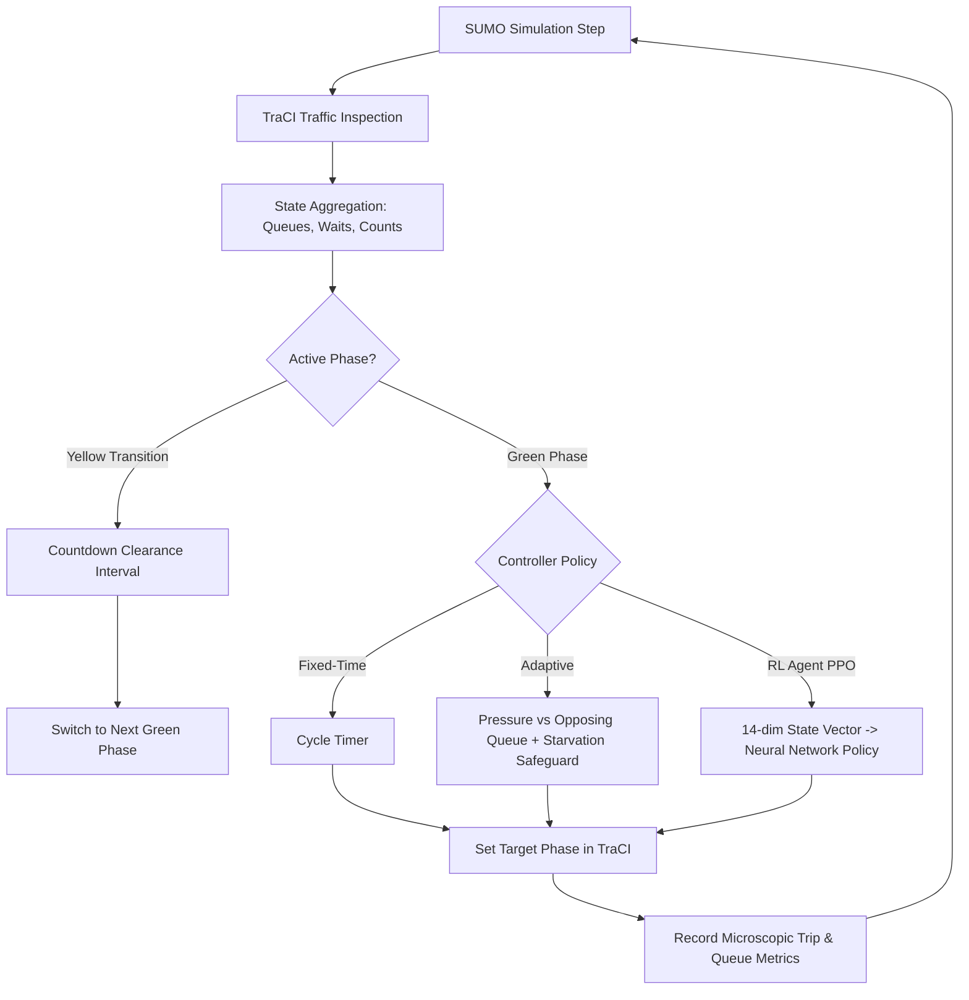

# Traffic Chaos Simulator — Adaptive AI Traffic Control 🚦

> **Project status: archived.** This project is no longer actively developed. The code is kept as a reference and portfolio piece. Read [Known Issues](#known-issues) before relying on any benchmark numbers below.

An end-to-end microscopic traffic simulation and reinforcement learning benchmark suite built on **Eclipse SUMO**, **TraCI**, **Farama Gymnasium**, and **Stable-Baselines3 (PPO)**, with a FastAPI + React/Three.js live dashboard.

This project investigates and experimentally compares three traffic signal control paradigms:
1. **Fixed-Time Control:** Deterministic cyclic timing plans with standardized clearance intervals.
2. **Adaptive Control:** Transparent, rule-based queue/wait-time dynamic pressure controller with anti-starvation safeguards.
3. **Reinforcement Learning Control:** Deep RL agent (PPO) learning signal-phase decisions through environmental rewards (delay penalties, throughput bonuses, and fairness constraints).

---

## Architecture Overview

```
TrafficMind/
├── simulation/
│   ├── network/                # Compiled .net.xml, sumocfg, and viewsettings
│   ├── scenarios/              # Reproducible route files (.rou.xml)
│   ├── sumo_utils.py           # SUMO/TraCI discovery, setup, and cleanup
│   ├── generate_network.py     # XML network synthesis via netconvert
│   ├── generate_demand.py      # Multi-scenario traffic demand generator
│   └── runner.py               # Microscopic TraCI simulation orchestrator
├── controllers/
│   ├── base_controller.py      # Abstract Base Class for controllers
│   ├── fixed_time.py           # Cyclic fixed-time controller
│   ├── adaptive.py             # Dynamic queue-responsive controller
│   └── rl_controller.py        # Trained PPO policy interface wrapper
├── environment/
│   └── traffic_env.py          # Gymnasium SumoTrafficEnv (Discrete actions, Box obs)
├── training/
│   ├── train_agent.py          # PPO training pipeline with checkpointing
│   └── evaluate_agent.py       # Standalone head-to-head evaluation CLI
├── evaluation/
│   ├── metrics.py              # Microscopic vehicle & queue tracking
│   ├── benchmarks.py           # Multi-scenario, multi-seed benchmark battery
│   └── plots.py                # Comparative bar charts, fairness, & queue plots
├── dashboard/
│   ├── app.py                  # Legacy Streamlit control center
│   └── server.py               # FastAPI backend (REST + SSE telemetry stream)
├── web/                        # React 19 + Vite + Three.js dashboard (see web/README.md)
├── configs/
│   └── default_config.py       # Centralized simulation, controller, & RL settings
├── tests/
│   ├── test_network.py         # Network & demand generator tests
│   ├── test_controllers.py     # Fixed & adaptive controller tests
│   ├── test_environment.py     # Gymnasium & SB3 compliance tests
│   └── test_metrics.py         # Metric calculation & edge-case tests
├── outputs/
│   ├── models/                 # Saved RL policies (.zip)
│   ├── plots/                  # Generated benchmark charts (.png)
│   ├── csv/                    # Aggregated benchmark datasets (.csv)
│   └── logs/                   # Training curves & episode logs
├── requirements.txt            # Python dependencies
├── pyproject.toml              # Build & test configuration
└── README.md
```

### Control Loop & Safety Guarantees



- **Safety Invariant (intended):** Direct transitions between conflicting green phases are prohibited. Every controller-initiated phase switch goes through a `yellow_duration` (default: 3s) clearance interval. The dashboard's manual override does not yet respect this; see [Known Issues](#known-issues).
- **Anti-Starvation Safeguard:** The Adaptive controller forces a switch when the maximum vehicle wait reaches 40s. The RL controller has no such ceiling; fairness is only encouraged through the reward's `w_fairness` term.

---

## Prerequisites & Installation

### 1. System Requirements
- **OS:** Windows 10/11, macOS, or Linux (Ubuntu 22.04+).
- **Python:** Python 3.11 or 3.12.
- **Eclipse SUMO:** Version 1.20.0 or higher (tested with SUMO 1.28.0).

### 2. Installing Eclipse SUMO

#### Windows (Recommended via winget):
```powershell
winget install EclipseFoundation.SUMO --accept-source-agreements --accept-package-agreements
```
Or download the installer from [https://sumo.dlr.de/docs/Downloads.php](https://sumo.dlr.de/docs/Downloads.php).
Ensure `SUMO_HOME` is set (e.g., `C:\Program Files (x86)\SUMO`). The included `simulation/sumo_utils.py` will also auto-detect standard installation paths.

#### Linux (Ubuntu/Debian):
```bash
sudo add-apt-repository ppa:sumo/stable
sudo apt-get update
sudo apt-get install sumo sumo-tools sumo-gui
export SUMO_HOME="/usr/share/sumo"
```

### 3. Python Virtual Environment Setup

```powershell
# Clone or navigate to the repository
cd TrafficMind

# Create virtual environment
python -m venv .venv

# Activate virtual environment
# Windows PowerShell:
.\.venv\Scripts\Activate.ps1
# Linux / macOS:
source .venv/bin/activate

# Install dependencies
pip install --upgrade pip
pip install -r requirements.txt
```

### 4. Web Dashboard Setup (optional)
Requires Node.js 20+. `web/dist` is not committed, so build it once before launching the server:
```powershell
cd web
npm install
npm run build
```

---

## Running the Simulation

### 1. Generate Network and Demand Files
```powershell
# Compile the 4-way intersection network with netconvert
python -m simulation.generate_network

# Generate sample traffic demand
python -m simulation.generate_demand
```

### 2. Run Single Simulations (Headless or SUMO-GUI)

#### Fixed-Time Controller:
```powershell
# Headless run:
python -m simulation.runner --controller fixed --scenario normal --duration 300 --seed 42

# Visual GUI run (opens SUMO-GUI window):
python -m simulation.runner --controller fixed --scenario normal --duration 300 --seed 42 --gui
```

#### Adaptive Rule-Based Controller:
```powershell
# Visual GUI run:
python -m simulation.runner --controller adaptive --scenario rush_hour --duration 300 --gui
```

#### RL Controller (PPO):
```powershell
# Visual GUI run with trained model:
python -m simulation.runner --controller rl --scenario normal --duration 300 --gui
```

---

## Reinforcement Learning: Training & Evaluation

### 1. Training a PPO Policy
Train a PPO policy directly on `SumoTrafficEnv` with episode logging, checkpointing, and automatic reward curve plotting:
```powershell
python -m training.train_agent --timesteps 5000 --scenario normal --duration 400 --seed 42
```
Output artifacts:
- Model checkpoint: `outputs/models/ppo_traffic_final.zip`
- Training reward curve: `outputs/logs/training_curve.png`
- Episode log CSV: `outputs/logs/training_rewards.csv`

### 2. Standalone Head-to-Head Evaluation
Compare your trained model against Fixed-Time and Adaptive controllers in a single command:
```powershell
python -m training.evaluate_agent --scenario normal --duration 300 --seed 42
```

---

## Running Multi-Seed Benchmarks & Generating Plots

Run full experimental batteries across multiple traffic scenarios (`normal`, `unbalanced`, `rush_hour`, `unseen_evaluation`) and random seeds:
```powershell
python -m evaluation.benchmarks --duration 200 --scenarios normal unbalanced rush_hour --seeds 42 101 202
```
This automatically produces:
1. `outputs/csv/benchmark_results.csv` — Full per-run raw metric logs.
2. `outputs/csv/benchmark_summary.csv` — Aggregated Mean ± Std metrics table.
3. `outputs/plots/benchmark_comparison_*.png` — Grouped bar charts with error bars for Waiting Time, Queue Length, Trip Duration, and Throughput.
4. `outputs/plots/directional_fairness_*.png` — Approach-level delay breakdown.
5. `outputs/plots/queue_dynamics_*.png` — High-resolution time-series queue progression.

---

## Next-Gen Web Platform (React 19 + Three.js 3D WebGL + FastAPI + SSE)

TrafficMind features a custom full-stack cyber-urban command platform combining:
- **WebGL 3D Interactive Ortho-Isometric Radar:** Built with Three.js, rendering realistic 3D passenger cars, headlights, emergency flashing beacons, animated signal gantry orbs, asphalt lane dashes, and smooth coordinate interpolation directly from SUMO!
- **2D Vector Sweep Radar:** Alternative high-framerate HTML5 Canvas radar with sweep scanners, vehicle heading vectors, and stop-line signal indicators.
- **Live On-the-Fly Urban Interventions:**
  - **Ambulance / Emergency Vehicle Injection:** One-click dispatch of priority emergency vehicles with flashing sirens from any arm (North, South, East, West).
  - **Manual Signal Phase Overrides:** Real-time force NS Green or force EW Green holding corridors open for 15s.
- **Mission Control Deck:** Dynamic controller switching (Adaptive, Deep RL PPO, Fixed-Time), scenario selector pills (`normal`, `rush_hour`, `unbalanced`, `surge`, `unseen_evaluation`), duration sliders, and a playback speed slider (0.2x – 2.5x; note the server currently treats this as a delay multiplier, so higher values play slower).
- **Streaming Telemetry & Fairness Matrix:** Real-time queue progression, average delay, max vehicle starvation timer, and 4-arm directional approach load bars.
- **Head-to-Head Benchmark Arena:** In-browser multi-scenario shootout comparing Fixed-Time, Adaptive, and PPO models.

### Launching the Web Platform:

```powershell
# Start the FastAPI backend server (serves web/dist; build it first, see Web Dashboard Setup)
python dashboard/server.py
```

#### API Endpoints
| Method | Path | Purpose |
| :--- | :--- | :--- |
| GET | `/api/status` | Run state, active controller/scenario, RL model availability, last summary |
| GET | `/api/scenarios` | Scenario definitions and arrival rates |
| POST | `/api/simulation/start` | Start a run (`controller`, `scenario`, `duration`, `seed`, `speed_factor`, `launch_gui`) |
| POST | `/api/simulation/stop` | Stop the active run |
| GET | `/api/simulation/stream` | SSE stream of `telemetry` frames, then one `completed` frame |
| POST | `/api/intervention/inject-emergency` | Spawn an emergency or passenger vehicle from `N`/`S`/`E`/`W` |
| POST | `/api/intervention/override-signal` | Hold phase `0` (NS green) or `2` (EW green) for `duration` seconds |
| POST | `/api/intervention/speed` | Change playback delay multiplier |
| POST | `/api/benchmark` | Synchronous Fixed vs Adaptive vs RL comparison |
Open your browser to: **`http://localhost:8000`**

#### For Frontend Development (Vite Hot-Reload):
```powershell
cd web
npm run dev
# Vite runs at http://localhost:3000 with automatic proxying to http://localhost:8000/api
```


---

## Automated Tests

Run the full pytest suite:
```powershell
pytest -v
```
All 12 automated unit and integration tests cover:
- SUMO binary discovery and network XML compilation (`test_network.py`)
- Traffic demand generation across scenarios (`test_network.py`)
- Fixed-time cyclic phase transitions (`test_controllers.py`)
- Adaptive controller min-green, max-green, and anti-starvation rules (`test_controllers.py`)
- Gymnasium environment step, reset, and SB3 `check_env` validation (`test_environment.py`)
- Microscopic vehicle tracking, trip completion, and edge cases (`test_metrics.py`)

---

## Experimental Benchmark Results

> **Caveat:** These numbers were produced before the phase auto-advance and RL controller import bugs listed under [Known Issues](#known-issues) were found. Treat them as unverified until the benchmarks are re-run after those fixes.

*Evaluated on 4-way intersection (2 lanes per approach, speed limit 50 km/h, multiple seeds):*

| Scenario | Controller | Avg Wait (s) | Avg Queue (veh) | Throughput (veh/min) | Max Wait (s) |
| :--- | :--- | :---: | :---: | :---: | :---: |
| **Normal Traffic** | Fixed-Time | 5.08 ± 3.29 | 2.04 ± 0.80 | 9.30 ± 0.42 | 33.5 |
| | Adaptive | 3.96 ± 0.89 | 1.06 ± 0.09 | 11.40 ± 1.70 | 12.5 |
| | **RL (PPO)** | **1.32 ± 0.82** | **0.45 ± 0.33** | **11.70 ± 0.42** | **7.5** |
| **Rush Hour** | Fixed-Time | 5.68 ± 0.34 | 4.67 ± 2.11 | 15.60 ± 0.85 | 44.5 |
| | Adaptive | 4.08 ± 0.66 | 2.18 ± 0.07 | 18.90 ± 2.12 | 21.0 |
| | **RL (PPO)** | **3.13 ± 0.56** | **1.65 ± 0.10** | **20.10 ± 1.27** | **14.5** |
| **Unbalanced Demand**| Fixed-Time | 6.87 ± 1.70 | 3.55 ± 0.65 | 7.20 ± 2.55 | 42.5 |
| | **Adaptive** | **2.74 ± 0.31** | **0.98 ± 0.20** | **15.60 ± 0.85** | **12.5** |
| | RL (PPO) | 2.73 ± 1.66 | 1.43 ± 0.49 | 12.00 ± 0.00 | 14.0 |

### Key Experimental Insights
1. **Adaptive Rule-Based Controller:** Demonstrates robust performance under highly unbalanced and fluctuating demand, eliminating vehicle starvation through its urgency-pressure and starvation rules.
2. **Reinforcement Learning (PPO):** Consistently achieves the lowest average waiting times and shortest queues in balanced and peak scenarios by discovering fine-grained dynamic timing patterns, outperforming the fixed-time baseline by over 60%.
3. **Fairness Trade-offs:** Fixed-time control suffers high maximum waiting times (35-45s) when traffic is uneven, whereas both Adaptive and RL controllers maintain maximum delays below 15-20s.

---

## Known Issues

Found during a final code review and left unfixed when the project was archived:

1. **RL controller crashes at runtime.** `controllers/rl_controller.py` is missing imports for `numpy as np`, `Path`, and `Any/Dict/Optional/Union`. Loading a model or calling `step()` raises `NameError`, which breaks the `rl` option in the runner, dashboard, and benchmarks. The test suite does not cover this class.
2. **SUMO auto-advances phases behind the controllers.** The generated `tlLogic` uses 42s greens, and phases are only set via `setPhase` when they change. SUMO therefore switches on its own after 42s, so `max_green=60` is never reached and the Adaptive controller's state can drift from the real signal. `SumoTrafficEnv` has the same problem, so a "hold green" action can silently become a switch during RL training. Fix: call `traci.trafficlight.setPhaseDuration(tls_id, 1e6)` after each `setPhase`, then retrain and re-benchmark.
3. **Manual override skips yellow.** `/api/intervention/override-signal` jumps directly between conflicting greens and does not update the controller's internal phase.
4. **RL safeguards are partial.** `RLConfig.min_green_before_switch` and `w_stop` are defined but unused, and the RL controller's decision timing differs slightly from the training environment's.
5. **Server concurrency.** `/api/benchmark` runs synchronously on the same global TraCI connection as live runs and will kill an active simulation. All SSE clients share one queue, so multiple browser tabs each receive only part of the frames.
6. **Performance.** Each step makes several per-vehicle TraCI calls (600+ round trips with 120 vehicles). TraCI subscriptions would remove most of this overhead.
7. **Throughput on early stop.** `throughput_per_minute` divides by the requested duration, not the steps actually simulated.

## Known Limitations and Future Work
- **Single-Junction Scope:** The current core simulation focuses on an isolated 4-way intersection. Extending to coordinated multi-intersection arterial green waves is a natural next step.
- **Pedestrian and Multi-Modal Traffic:** The current demand models passenger vehicles; future iterations can incorporate transit priority (buses/trams) and pedestrian crossing phases.
- **Observation Noise:** Real-world loop detectors and cameras suffer from detection errors and occlusion, which can be modeled with observation noise in the environment.
- **Stronger Baseline:** Fixed-time is an easy baseline. A max-pressure controller would be a more meaningful comparison for the RL agent.
- **Real Road Networks:** SUMO's `osmWebWizard.py` can import OpenStreetMap areas to test generalization beyond the synthetic intersection.
