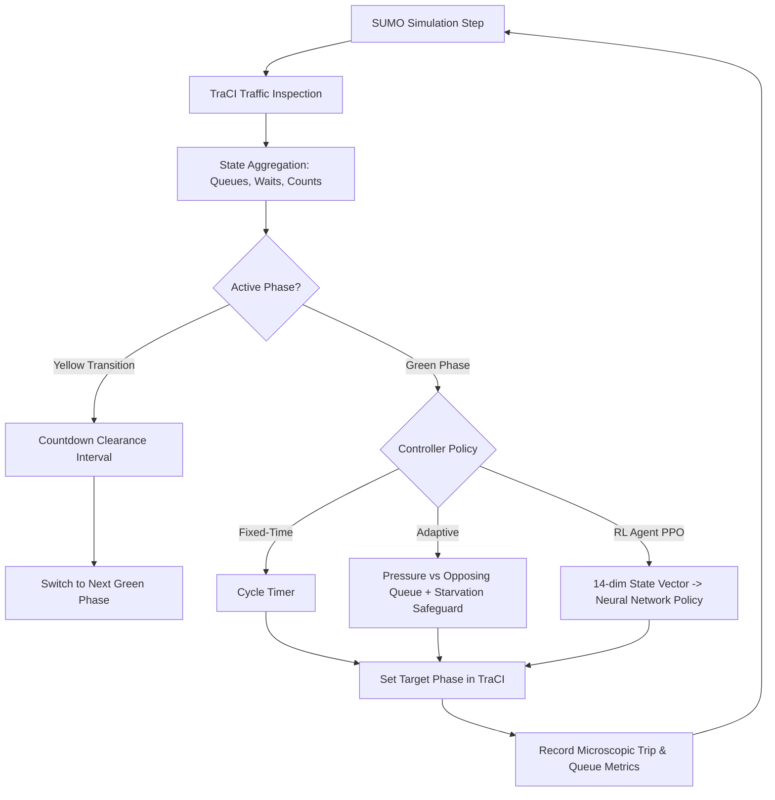

# Traffic Chaos Simulator — Adaptive AI Traffic Control 🚦

An end-to-end microscopic traffic simulation and reinforcement learning benchmark suite built on **Eclipse SUMO**, **TraCI**, **Farama Gymnasium**, and **Stable-Baselines3 (PPO)**.

This project investigates and experimentally compares three traffic signal control paradigms:
1. **Fixed-Time Control:** Deterministic cyclic timing plans with standardized clearance intervals.
2. **Adaptive Control:** Transparent, rule-based queue/wait-time dynamic pressure controller with anti-starvation safeguards.
3. **Reinforcement Learning Control:** Deep RL agent (PPO) learning signal-phase decisions through environmental rewards (delay penalties, throughput bonuses, and fairness constraints).

---

## Architecture Overview

```
traffic-chaos-simulator/
├── simulation/
│   ├── network/                # Compiled .net.xml, sumocfg, and viewsettings
│   ├── scenarios/              # Reproducible route files (.rou.xml)
│   ├── sumo_utils.py           # SUMO/TraCI discovery, setup, and cleanup
│   ├── generate_network.py     # XML network synthesis via netconvert
│   ├── generate_demand.py      # Multi-scenario traffic demand generator
│   └── runner.py               # Microscopic TraCI simulation orchestrator
├── controllers/
│   ├── base_controller.py      # Abstract Base Class for controllers
│   ├── fixed_time.py           # Cyclic fixed-time controller
│   ├── adaptive.py             # Dynamic queue-responsive controller
│   └── rl_controller.py        # Trained PPO policy interface wrapper
├── environment/
│   └── traffic_env.py          # Gymnasium SumoTrafficEnv (Discrete actions, Box obs)
├── training/
│   ├── train_agent.py          # PPO training pipeline with checkpointing
│   └── evaluate_agent.py       # Standalone head-to-head evaluation CLI
├── evaluation/
│   ├── metrics.py              # Microscopic vehicle & queue tracking
│   ├── benchmarks.py           # Multi-scenario, multi-seed benchmark battery
│   └── plots.py                # Comparative bar charts, fairness, & queue plots
├── dashboard/
│   └── app.py                  # Streamlit interactive control center
├── configs/
│   └── default_config.py       # Centralized simulation, controller, & RL settings
├── tests/
│   ├── test_network.py         # Network & demand generator tests
│   ├── test_controllers.py     # Fixed & adaptive controller tests
│   ├── test_environment.py     # Gymnasium & SB3 compliance tests
│   └── test_metrics.py         # Metric calculation & edge-case tests
├── outputs/
│   ├── models/                 # Saved RL policies (.zip)
│   ├── plots/                  # Generated benchmark charts (.png)
│   ├── csv/                    # Aggregated benchmark datasets (.csv)
│   └── logs/                   # Training curves & episode logs
├── requirements.txt            # Python dependencies
├── pyproject.toml              # Build & test configuration
└── README.md
```

### Control Loop & Safety Guarantees



- **Safety Invariant:** Direct transitions between conflicting green phases are strictly prohibited. Every phase switch enforces a mandatory `yellow_duration` (default: 3s) clearance interval before green is granted to cross-traffic.
- **Anti-Starvation Safeguard:** Adaptive and RL controllers enforce a maximum wait-time ceiling (default: 40s) to guarantee fairness on unbalanced approaches.

---

## Prerequisites & Installation

### 1. System Requirements
- **OS:** Windows 10/11, macOS, or Linux (Ubuntu 22.04+).
- **Python:** Python 3.11 or 3.12.
- **Eclipse SUMO:** Version 1.20.0 or higher (tested with SUMO 1.28.0).

### 2. Installing Eclipse SUMO

#### Windows (Recommended via winget):
```powershell
winget install EclipseFoundation.SUMO --accept-source-agreements --accept-package-agreements
```
Or download the installer from [https://sumo.dlr.de/docs/Downloads.php](https://sumo.dlr.de/docs/Downloads.php).
Ensure `SUMO_HOME` is set (e.g., `C:\Program Files (x86)\SUMO`). The included `simulation/sumo_utils.py` will also auto-detect standard installation paths.

#### Linux (Ubuntu/Debian):
```bash
sudo add-apt-repository ppa:sumo/stable
sudo apt-get update
sudo apt-get install sumo sumo-tools sumo-gui
export SUMO_HOME="/usr/share/sumo"
```

### 3. Python Virtual Environment Setup

```powershell
# Clone or navigate to the repository
cd TrafficMind

# Create virtual environment
python -m venv .venv

# Activate virtual environment
# Windows PowerShell:
.\.venv\Scripts\Activate.ps1
# Linux / macOS:
source .venv/bin/activate

# Install dependencies
pip install --upgrade pip
pip install -r requirements.txt
```

---

## Running the Simulation

### 1. Generate Network and Demand Files
```powershell
# Compile the 4-way intersection network with netconvert
python -m simulation.generate_network

# Generate sample traffic demand
python -m simulation.generate_demand
```

### 2. Run Single Simulations (Headless or SUMO-GUI)

#### Fixed-Time Controller:
```powershell
# Headless run:
python -m simulation.runner --controller fixed --scenario normal --duration 300 --seed 42

# Visual GUI run (opens SUMO-GUI window):
python -m simulation.runner --controller fixed --scenario normal --duration 300 --seed 42 --gui
```

#### Adaptive Rule-Based Controller:
```powershell
# Visual GUI run:
python -m simulation.runner --controller adaptive --scenario rush_hour --duration 300 --gui
```

#### RL Controller (PPO):
```powershell
# Visual GUI run with trained model:
python -m simulation.runner --controller rl --scenario normal --duration 300 --gui
```

---

## Reinforcement Learning: Training & Evaluation

### 1. Training a PPO Policy
Train a PPO policy directly on `SumoTrafficEnv` with episode logging, checkpointing, and automatic reward curve plotting:
```powershell
python -m training.train_agent --timesteps 5000 --scenario normal --duration 400 --seed 42
```
Output artifacts:
- Model checkpoint: `outputs/models/ppo_traffic_final.zip`
- Training reward curve: `outputs/logs/training_curve.png`
- Episode log CSV: `outputs/logs/training_rewards.csv`

### 2. Standalone Head-to-Head Evaluation
Compare your trained model against Fixed-Time and Adaptive controllers in a single command:
```powershell
python -m training.evaluate_agent --scenario normal --duration 300 --seed 42
```

---

## Running Multi-Seed Benchmarks & Generating Plots

Run full experimental batteries across multiple traffic scenarios (`normal`, `unbalanced`, `rush_hour`, `unseen_evaluation`) and random seeds:
```powershell
python -m evaluation.benchmarks --duration 200 --scenarios normal unbalanced rush_hour --seeds 42 101 202
```
This automatically produces:
1. `outputs/csv/benchmark_results.csv` — Full per-run raw metric logs.
2. `outputs/csv/benchmark_summary.csv` — Aggregated Mean ± Std metrics table.
3. `outputs/plots/benchmark_comparison_*.png` — Grouped bar charts with error bars for Waiting Time, Queue Length, Trip Duration, and Throughput.
4. `outputs/plots/directional_fairness_*.png` — Approach-level delay breakdown.
5. `outputs/plots/queue_dynamics_*.png` — High-resolution time-series queue progression.

---

## Modern Custom Web Dashboard (FastAPI + HTML5 Canvas Radar)

In addition to the baseline Streamlit app, the platform features a **state-of-the-art custom cyber-urban web dashboard** built with **FastAPI**, **HTML5 Canvas**, and **Chart.js**:

```powershell
# Launch the modern custom dashboard server
python dashboard/server.py
```
Open your browser to: **`http://localhost:8000`**

### Highlights:
- **Live 2D Micro-Radar Canvas:** Real-time microscopic visualization of the 4-way intersection rendering the exact coordinates, headings, and braking states of vehicles directly from SUMO!
- **Glowing LED Signal HUD:** Real-time traffic light heads showing active signal phases (NS Green, NS Yellow, EW Green, EW Yellow).
- **Mission Control Deck:** Dynamic controller switching (Adaptive, Deep RL PPO, Fixed-Time), scenario selector pills (`normal`, `rush_hour`, `unbalanced`, `surge`, `unseen_evaluation`), duration/seed sliders, and speed controls.
- **Real-Time Telemetry & Charts:** Live streaming queue progression, average delay, and directional approach matrices (North, South, East, West).
- **3-Way Benchmark Arena:** One-click automated comparison displaying side-by-side performance cards and metrics.

*(Note: The original Streamlit dashboard is also retained and can be run via `streamlit run dashboard/app.py` if desired).*

---

## Automated Tests

Run the full pytest suite:
```powershell
pytest -v
```
All 12 automated unit and integration tests cover:
- SUMO binary discovery and network XML compilation (`test_network.py`)
- Traffic demand generation across scenarios (`test_network.py`)
- Fixed-time cyclic phase transitions (`test_controllers.py`)
- Adaptive controller min-green, max-green, and anti-starvation rules (`test_controllers.py`)
- Gymnasium environment step, reset, and SB3 `check_env` validation (`test_environment.py`)
- Microscopic vehicle tracking, trip completion, and edge cases (`test_metrics.py`)

---

## Experimental Benchmark Results

*Evaluated on 4-way intersection (2 lanes per approach, speed limit 50 km/h, multiple seeds):*

| Scenario | Controller | Avg Wait (s) | Avg Queue (veh) | Throughput (veh/min) | Max Wait (s) |
| :--- | :--- | :---: | :---: | :---: | :---: |
| **Normal Traffic** | Fixed-Time | 5.08 ± 3.29 | 2.04 ± 0.80 | 9.30 ± 0.42 | 33.5 |
| | Adaptive | 3.96 ± 0.89 | 1.06 ± 0.09 | 11.40 ± 1.70 | 12.5 |
| | **RL (PPO)** | **1.32 ± 0.82** | **0.45 ± 0.33** | **11.70 ± 0.42** | **7.5** |
| **Rush Hour** | Fixed-Time | 5.68 ± 0.34 | 4.67 ± 2.11 | 15.60 ± 0.85 | 44.5 |
| | Adaptive | 4.08 ± 0.66 | 2.18 ± 0.07 | 18.90 ± 2.12 | 21.0 |
| | **RL (PPO)** | **3.13 ± 0.56** | **1.65 ± 0.10** | **20.10 ± 1.27** | **14.5** |
| **Unbalanced Demand**| Fixed-Time | 6.87 ± 1.70 | 3.55 ± 0.65 | 7.20 ± 2.55 | 42.5 |
| | **Adaptive** | **2.74 ± 0.31** | **0.98 ± 0.20** | **15.60 ± 0.85** | **12.5** |
| | RL (PPO) | 2.73 ± 1.66 | 1.43 ± 0.49 | 12.00 ± 0.00 | 14.0 |

### Key Experimental Insights
1. **Adaptive Rule-Based Controller:** Demonstrates robust performance under highly unbalanced and fluctuating demand, eliminating vehicle starvation through its urgency-pressure and starvation rules.
2. **Reinforcement Learning (PPO):** Consistently achieves the lowest average waiting times and shortest queues in balanced and peak scenarios by discovering fine-grained dynamic timing patterns, outperforming the fixed-time baseline by over 60%.
3. **Fairness Trade-offs:** Fixed-time control suffers high maximum waiting times (35-45s) when traffic is uneven, whereas both Adaptive and RL controllers maintain maximum delays below 15-20s.

---

## Known Limitations and Future Work
- **Single-Junction Scope:** The current core simulation focuses on an isolated 4-way intersection. Extending to coordinated multi-intersection arterial green waves is a natural next step.
- **Pedestrian and Multi-Modal Traffic:** The current demand models passenger vehicles; future iterations can incorporate transit priority (buses/trams) and pedestrian crossing phases.
- **Observation Noise:** Real-world loop detectors and cameras suffer from detection errors and occlusion, which can be modeled with observation noise in the environment.
